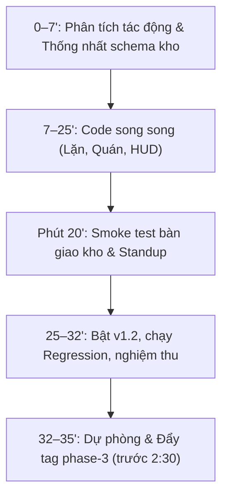

# TICKET-03 — Change Request “Mùa Nước Nổi” (Phase 3)

> **Thông tin Phase 3**:
> - **Thời lượng**: 35 phút (1:55–2:30) · Day 12 · AI SDLC
> - **Tiêu chuẩn**: Test Contract v1.2
> - **Mốc quan trọng**: Hạn đẩy tag `phase-3` lúc **2:30**

Tháng Tám âm lịch, nước lũ về, cá linh nhiều. Trời nóng làm nguyên liệu mau ươn. Khách hàng muốn biết độ tươi của từng nguyên liệu, từ lúc Út Sen lấy được đến khi đưa vào bếp.  
*(Ghi chú: Nhãn `[THAY THẾ]` đánh dấu các luật thay đổi so với bản đang chạy ở Phase 2).*

---

## 1. Lõi (mọi nhóm) — Độ tươi nguyên liệu

### 1.1. `[THAY THẾ]` Chuyển đổi: Kho đếm theo loại → Kho cá thể

Thay vì lưu trữ số lượng gộp theo loại, kho chuyển sang quản lý từng cá thể nguyên liệu với độ tươi riêng biệt:

```json
{
  "items": [
    {"id": "I1", "kind": "ca_linh", "fresh": 100},
    {"id": "I2", "kind": "ca_loc", "fresh": 97.5}
  ]
}
```

- **Quy tắc cấu trúc**:
  - File có đúng khóa gốc `"items"`, giá trị là mảng các cá thể `{"id", "kind", "fresh"}`.
  - Kho rỗng biểu diễn là `{"items": []}`.
  - `id`: Chuỗi duy nhất, khác rỗng. Cấp tuần tự `I1`, `I2`,… theo thứ tự vào giỏ; tiếp tục tăng xuyên pha và xuyên Ngày, kể cả khi cá thể trước đó đã dùng hoặc bỏ.
  - `kind`: Thuộc danh mục nguyên liệu hợp lệ.
  - `fresh`: Số thực hữu hạn trong đoạn $[0, 100]$.
  - Rơi rớt hàng (LIFO): Khi mất hàng, vẫn rút bỏ theo thứ tự vào giỏ (LIFO).
- **Hợp đồng & Kiểm tra tính hợp lệ**:
  - Bên đọc chọn schema theo `contract_version`.
  - **Contract v1.2 trả mã thoát `2`** nếu file dùng kho đếm cũ, sai schema, `kind` lạ, `id` trùng hoặc `fresh` nằm ngoài miền $[0, 100]$.
  - Kho quán nhận nguyên số lượng, `id` và độ tươi, kể cả các cá thể đã ươn.
  - Sức chứa giỏ (`hold_capacity`) chỉ áp dụng lên giỏ của người chơi ở pha lặn.
- **Bàn giao kho qua file & trong chế độ `day`**:
  - Lệnh `gather --inventory-out`: Ghi đúng một lần khi xuất hiện sự kiện `gather_end`. Dùng file tạm cùng thư mục rồi thay thế nguyên tử (atomic rename).
  - Ngất (`fainted`): Ghi file kho rỗng.
  - Hết giờ trước khi kết thúc: Nếu chạm giới hạn `--ticks` trước `gather_end`, giữ nguyên đường dẫn đích (không ghi đè file hỏng).
  - Xuất file theo `id`: Đảm bảo đủ độ chính xác khi đọc lại để bảo toàn giá trị và rẽ nhánh chính xác tại ngưỡng 30. `gather_end.data.inventory` tuân theo cùng schema này.
  - Trong mode `day`: Bàn giao nguyên liệu trong cùng tick chuyển pha, hàng không hao thêm trong lúc giao, ca quán bắt đầu chạy từ bước tiếp theo.
  - Chợ Chú Sáu (Shop): Hàng mua nhập riêng vào kho quán Ngày kế tiếp với `fresh: 100`, tách khỏi `gather_end.inventory` và được cấp `id` mới. Hàng thô ở Shop hoặc hàng đang chờ nhập không bị hao tươi. Khi người chơi bán hàng thô, chọn cá thể chưa ươn tươi nhất của loại đó, hòa theo `id`.

---

### 1.2. Độ tươi, Giữ chỗ và Định giá

| Quy tắc | Cách xử lý chi tiết |
| :--- | :--- |
| **Hàng mới** | `fresh = 100` ngay tại thời điểm bắt cá hoặc hái nút; bắt đầu hao tươi từ bước mô phỏng kế tiếp. |
| **Tốc độ hao tươi** | • **Giỏ lặn**: Giảm **$0.5$/giây** ($0.5 / 60$ mỗi tick).<br>• **Kho quán**: Giảm **$0.25$/giây** ($0.25 / 60$ mỗi tick), tính cả các nguyên liệu đang được giữ chỗ.<br>• Mỗi giây gồm 60 tick, giá trị kẹp đáy ở $0$. Trạng thái `pause` dừng hao tươi. Món đã nấu chín không hao tươi. |
| **Nguyên liệu ươn** | • Ngưỡng: `fresh < 30`. Cá thể ươn vẫn chiếm ô chứa nhưng **không được dùng để nấu**.<br>• Sự kiện `spoiled`: Phát đúng một lần khi độ tươi đi từ $\ge 30$ xuống $< 30$. Nếu nhiều cá thể cùng vượt ngưỡng trong 1 tick, phát lần lượt theo thứ tự `id`. So sánh ngưỡng trước khi làm tròn. |
| **`[THAY THẾ]` Giữ chỗ theo cá thể** *(thay cho giữ theo lượng)* | • Với mỗi loại nguyên liệu trong công thức món, lấy các cá thể khả dụng **tươi nhất**, hòa theo `id` nhỏ hơn.<br>• Nếu trong phần giữ chỗ có cá thể vừa bị ươn: Nhả toàn bộ phần giữ của đơn đó và thử giữ lại đúng một lần.<br>• Thứ tự xử lý các đơn bị ảnh hưởng: Sắp xếp theo `order_tick` tăng dần, sau đó theo `id` bàn.<br>• Nếu không đủ nguyên liệu tươi: Đơn thường chuyển sang `unfulfillable`, khách tiếp tục ngồi chờ đến khi hết kiên nhẫn. |
| **`[THAY THẾ]` Giá theo độ tươi** *(thay cho giá niêm yết)* | • Khi bắt đầu nấu (`cook_started`): Tiêu hao đúng các `id` nguyên liệu đang giữ chỗ và chốt giá:<br>$$\text{base\_price} = \left\lfloor \text{giá niêm yết} \times \frac{\text{trung bình fresh của các cá thể sử dụng}}{100} \right\rfloor$$<br>• Tiền boa: Nếu đủ điều kiện nhận boa, áp dụng $\lfloor \text{tiền món} \times 0.2 \rfloor$ dựa trên giá đã chốt.<br>• Điểm tổng kết: Vẫn tính theo công thức $\text{earned} + 100 \times \lfloor \text{reputation} \rfloor$. |
| **HUD hiển thị** | Cung cấp thông tin để người chơi nhận biết độ tươi hoặc cảnh báo hàng ươn thông qua số liệu, thanh tiến trình, nhãn hoặc biểu tượng đồ họa. |

> [!TIP]
> **Độ chính xác tính toán tại ngưỡng 30**:
> Để tránh sai số dấu phẩy động làm nhảy sai nhánh tại ngưỡng 30, khuyến nghị sử dụng biểu diễn số nguyên quy ước (ví dụ: $240$ đơn vị cho mỗi điểm tươi; mỗi tick trừ $2$ đơn vị ở pha gather và $1$ đơn vị ở pha quán).

---

### 1.3. Thứ tự xử lý trong một Tick

#### Pha Lặn (`gather`)
1. Cập nhật đồng hồ, cooldown, đếm lùi hồi nút hái và **hao tươi của hàng đang có trong giỏ** (đặt ở đầu bước).
2. Kiểm tra lịch dòng nước lũ (nếu đang bật mở rộng).
3. Di chuyển người chơi, tính toán tiêu hao oxy và mất máu do ngạt thở.
4. Xử lý phóng lao (nếu có), tuần tra/đuổi/va chạm thủy quái (áp dụng sát thương, bất tử, recoil).
5. Tương tác: Ưu tiên bến (`docked`) trước nút hái (`gather`).
6. Bắt cá (`catch`), chụp ảnh cá (nếu có).
7. Kiểm tra hết giờ: Nếu vẫn còn thời gian, cập nhật vị trí bơi của đàn cá và chu kỳ sinh cá mới.
8. **Rơi đồ & Ngất**: Rơi rớt đồ theo LIFO. Khi ngất (`hp <= 0`), bỏ toàn bộ phần giỏ còn lại theo thứ tự LIFO, sau đó phát sự kiện `faint` và kết thúc với `gather_end(fainted)`.

#### Pha Quán (`quan`)
1. Cập nhật đồng hồ và timer.
2. **Hao tươi kho thô**, phát toàn bộ sự kiện `spoiled` theo thứ tự `id`, sau đó mới xử lý lại các phần giữ chỗ có nguyên liệu vừa ươn.
3. Kiểm tra món chín / cháy (nếu có) theo thứ tự `id` bếp.
4. Di chuyển người chơi và thực hiện tối đa một tương tác (lấy kho, đặt bếp, bưng món, phục vụ bàn).
5. Xử lý thanh toán, giảm kiên nhẫn của khách, kiểm tra đóng ca.
6. Nếu vẫn còn thời gian ca: Xử lý khách đặt trước (nếu có) theo `id`, sau đó mới tới lượt khách thường.
7. *Quy tắc biên*: Giao món đúng tick kiên nhẫn chạm 0 vẫn được tính hợp lệ; giao món đúng tick kết thúc ca vẫn được thanh toán ngay.

---

### 1.4. Chi tiết Test Contract v1.2

- **`contract_version`**: Đặt thành `"1.2"`.
- **Cấu hình `freshness`**: Bổ sung vào contract tham số:
  ```json
  "freshness": {
    "initial": 100,
    "gather_decay_per_s": 0.5,
    "quan_decay_per_s": 0.25,
    "spoiled_below": 30
  }
  ```
- **Quy định Scenario**:
  - `gather.hold` và `quan.stock`: Chuyển thành mảng cá thể `[{"id", "kind", "fresh"}]`.
  - Trong mode `day`: Ngày đầu tiên giữ nguyên `id` từ fixture `gather.hold`; các Ngày tiếp theo cấp `id` mới theo thứ tự mảng với `kind` và `fresh` ban đầu.
  - `customers[].reserved`: Chuyển thành mảng các chuỗi `id` cá thể (ví dụ: `["I1", "I3"]`).
  - Đảm bảo `id` vật lý là duy nhất trên toàn bộ các nơi chứa (giỏ, kho, món nấu).
  - Phần giữ chỗ phải trỏ tới cá thể **chưa ươn** trong kho, đủ số lượng theo công thức và không dùng trùng với đơn khác.
  - Nếu scenario lược bỏ `reserved` cho đơn đặt: Hệ thống tự cấp theo `order_tick` rồi `id` bàn, ưu tiên cá thể tươi nhất rồi đến `id` nhỏ hơn. Mọi sai lệch hoặc mâu thuẫn dữ liệu đều phải trả mã lỗi `2`.
  - Cấu trúc payload của món nấu giữ nguyên, trong đó `base_price` là giá đã được chốt theo độ tươi.
- **Quy định Snapshot & Event JSONL**:
  - Snapshot: `hold`, `stock` (ở quán và Shop), và `customers[].reserved` xuất theo schema mảng cá thể ở trên.
  - Event `cook_started.data.items`: Mảng các cá thể nguyên liệu, sắp xếp theo `kind` rồi theo `id`.
  - Event `monster_hit` và `faint`: Mảng `lost` chứa các cá thể bị mất theo đúng thứ tự LIFO.
  - Event mới **`spoiled`**:
    ```json
    {"type": "event", "tick": 1, "phase": "gather", "name": "spoiled", "data": {"item_id": "I1", "kind": "ca_linh", "location": "hold"}}
    ```
    (`location` nhận giá trị `"hold"` hoặc `"stock"`).
  - Dung sai quan sát độ tươi: $\pm 0.01$. Kiểm tra rẽ nhánh chính xác tuyệt đối tại ngưỡng 30.

#### Mẫu Scenario kiểm tra ngưỡng ươn:
```json
{"gather": {"hold": [{"id": "I1", "kind": "ca_linh", "fresh": 30}], "random_fish": false, "monsters": []}}
```
*Kỳ vọng ở bước đầu tiên (không có phím bấm):*
```json
{"type": "event", "tick": 1, "phase": "gather", "name": "spoiled", "data": {"item_id": "I1", "kind": "ca_linh", "location": "hold"}}
```

#### Quy trình Smoke Test bàn giao kho:
Chạy kịch bản trên với `fresh: 100` và `interact: true` tại frame 0 để cập bến ngay lập tức. Sau đó gọi lệnh `quan --inventory` với file kho vừa tạo và tham số `--ticks 0`. Đối chiếu chính xác `id`, `kind` và độ tươi giữa snapshot quán và file sau đúng 1 lần hao ở bước gather.

---

## 2. Phần Mở rộng (Extensions)

> [!NOTE]
> **Yêu cầu mở rộng theo quy mô nhóm (tính cho toàn buổi lab)**:
> - **Nhóm 4 người**: Không bắt buộc.
> - **Nhóm 5 người**: Bắt buộc hoàn thành ít nhất **1 mục**.
> - **Nhóm 6 người**: Bắt buộc hoàn thành ít nhất **2 mục**.
> *(Chỉ triển khai mở rộng sau khi tính năng Độ tươi và Bàn giao kho cá thể đã vận hành hoàn toàn ổn định).*

---

### 2.1. Mở rộng 1: Dòng nước lũ (`current`)

| Đặc tính | Quy tắc xử lý |
| :--- | :--- |
| **Lịch trình xuất hiện** | • Tại $t = 1.800 \cdot k$ ($k \ge 1$): Báo trước tại $t - 120$ bằng chữ, hình ảnh và âm thanh.<br>• Bắt đầu trước khi di chuyển tại tick $t$, duy trì trong **480 tick** (8 giây), từ $t$ đến $t + 479$. |
| **Hướng & Tác động lực** | • Hướng dòng: Chọn ngẫu nhiên đều $+x$ hoặc $-x$ theo seed tại thời điểm bắt đầu.<br>• Lực đẩy: Cộng thêm **1.5 m/s** vào vận tốc người chơi nếu độ sâu đầu bước $d \ge 10$, sau đó kẹp biên bản đồ.<br>• Đàn cá và thủy quái giữ chuyển động độc lập (không bị dòng cuốn). Lực dòng không tích lũy vào `player.vel`. |
| **Kết thúc dòng chảy** | • Phát sự kiện `current_end(elapsed)` ngay trước khi di chuyển tại tick $t + 480$.<br>• Nếu ca lặn kết thúc trước: Phát `current_end(phase_end)` trước sự kiện `faint` (nếu có) và trước `gather_end`.<br>• Nếu bước bắt đầu dòng trùng với bước cuối ca, lực đẩy vẫn tác động ở bước đó. |

- **Cấu hình & Dữ liệu**:
  - Manifest khai báo thêm trong `gather.current`: `{interval_ticks, duration_ticks, warning_ticks, min_depth, speed}`.
  - Scenario hỗ trợ cờ:
    - `gather.random_current: false` (tắt dòng lũ tự động).
    - `gather.current_direction: -1 | 1` (cố định hướng của dòng lũ khi chạy theo lịch).
  - Snapshot `gather`: Chứa trường `"current"` mang giá trị `null` hoặc `{"direction": int, "ticks_left": int}`.
- **Sự kiện liên quan**:
  | Event | Thuộc tính `data` |
  | :--- | :--- |
  | `current_warning` | `{"starts_at_phase_tick": int}` |
  | `current_start` | `{"direction": -1\|1, "duration_ticks": int}` |
  | `current_end` | `{"direction": -1\|1, "reason": "elapsed" \| "phase_end"}` |

---

### 2.2. Mở rộng 2: Khách đặt trước (`reservations`)

- **Công bố đơn**: Mỗi Ngày công bố 2 đơn đặt trước `R1`, `R2` ngay sau sự kiện `phase_start(gather)` theo thứ tự `id`. Giao diện HUD sáng lên hiển thị cả 2 đơn. Chọn 2 bàn khác nhau, món nằm trong kế hoạch ngày, tick đến sinh ngẫu nhiên theo seed trong đoạn $[1.800, 10.799]$.
- **Vòng đời trạng thái**: `scheduled` → `holding` → `waiting` → `served` hoặc `failed`.
  - Giữ bàn từ $\max(0, \text{arrival\_tick} - 1.800)$. Nếu giữ từ tick 0, phải thể hiện trạng thái ngay trong snapshot khởi tạo quán.
  - Khách thường đang ngồi sẵn được phép ngồi tiếp đến khi ăn xong; khách mới tuyệt đối không được ngồi vào bàn đang giữ chỗ.
  - Khi vẫn còn thời gian ca, hệ thống cập nhật việc giữ bàn và xử lý khách đặt theo thứ tự `id` trước lượt khách thường.
- **Thời điểm khách đến**:
  - Bàn còn khách thường ngồi: Thất bại với lý do `occupied`.
  - Bàn trống nhưng kho không đủ nguyên liệu tươi để giữ chỗ: Thất bại với lý do `stock`.
  - Khách đến thành công: Giữ nguyên liệu ngay lập tức, phát sự kiện `reservation_arrived`, tiếp theo là `customer_arrived`. Thời gian kiên nhẫn là 60 giây.
  - Định giá: Giá món chốt bằng $\lfloor \text{giá đã chốt theo fresh} \times 1.5 \rfloor$, sau đó mới tính tiền boa nếu có. Giao món thành công phát sự kiện `served`, tiếp theo là `reservation_served`.
- **Xử lý thất bại (Lỡ đơn)**:
  - Do `stock`, `occupied`, `burnt`, `patience` hoặc đóng ca (`closing`): Nhả nguyên liệu/bàn, hủy bỏ món đang nấu dở, trừ **1 điểm uy tín** (`reputation -= 1`) đúng một lần duy nhất.
  - Phát sự kiện `reservation_failed` thay cho nhánh rời đi của khách thường (không phạt thêm lỗi khách thường).
  - Nếu nguyên liệu giữ chỗ bị ươn mà kho không đủ để giữ lại: Thất bại với lý do `stock`.
  - Nếu món đang nấu bị cháy: Phát `dish_burnt` với `order_status: "failed"` trước `reservation_failed`.
  - Khi đóng ca: Tự động đánh trượt các đơn chưa phục vụ/chưa thất bại theo thứ tự `id`. `served` và `failed` là hai trạng thái kết thúc.
- **Cấu hình & Dữ liệu**:
  - Manifest thêm `reservations`: `{count: 2, table_hold_s: 30, price_multiplier: 1.5, failed_reputation_delta: -1}`.
  - Scenario hỗ trợ:
    - `quan.reservations`: Mảng các đối tượng `[{"id", "table_id", "dish_id", "arrival_tick"}]`.
    - `quan.random_reservations: false`: Tắt tính năng tự sinh đơn đặt ngẫu nhiên.
  - Snapshot:
    - Snapshot `gather` trong mode `day` và snapshot `quan` có mảng `reservations` kèm trạng thái `state`.
    - Snapshot `quan` bổ sung trường `reservation_id` (hoặc `null`) trong mỗi phần tử của `customers` và `tables`.
- **Sự kiện liên quan**:
  | Event | Thuộc tính `data` |
  | :--- | :--- |
  | `reservation_announced` | `{"reservation_id": str, "table_id": str, "dish_id": str, "arrival_tick": int}` |
  | `reservation_arrived` | `{"reservation_id": str, "order_id": str}` |
  | `reservation_served` | `{"reservation_id": str, "order_id": str, "base_price": int}` *(đã nhân 1.5 và làm tròn xuống)* |
  | `reservation_failed` | `{"reservation_id": str, "reason": str, "reputation": float}` |

---

## 3. Quy trình làm việc & Phối hợp nhóm

- **Quy tắc làm việc trên Git**:
  - Nhóm commit vào fork chung bằng tài khoản GitHub riêng của từng thành viên.
  - Khi cặp đôi (pair) cùng làm một commit, thêm dòng `Co-authored-by: Name <email>` vào nội dung commit.

### 3.1. Phân tích tác động & Kế hoạch tích hợp (7 phút đầu)

Các nhóm nên dành 7 phút đầu để lập kế hoạch, đánh giá tác động lên từng module, thống nhất thứ tự tích hợp để nhánh `main` luôn hoạt động và vượt qua test.

#### Bảng mẫu phân tích tác động:
| Module | File cần đổi | Test bị ảnh hưởng | Người phụ trách |
| :--- | :--- | :--- | :--- |
| **Contract & Adapter** | `chonoi/contract.py`, `chonoi/inventory.py` | Migration tests, schema validator | *Thắng / Nam* |
| **Lặn (`gather`)** | `chonoi/sim/gather.py` | Lặn, hao tươi giỏ, nhả đồ ươn, LIFO | *Hải* |
| **Quán (`quan`)** | `chonoi/sim/quan.py` | Kho cá thể, hao tươi kho, giữ chỗ theo id, tính giá | *Nam* |
| **Day & Shop** | `chonoi/runner.py`, `chonoi/sim/day.py` | Bàn giao kho cá thể, nhập hàng Shop | *Thắng* |
| **Giao diện HUD** | `chonoi/web/index.html` | Hiển thị độ tươi, cảnh báo ươn, đơn đặt | *Tú* |

- **Chiến lược tích hợp**:
  - Hoàn thiện schema mới và lớp adapter trước.
  - Phát triển song song module Lặn, Quán và HUD theo schema cá thể đã thống nhất.
  - Có thể duy trì tương thích 2 phiên bản trong giai đoạn chuyển đổi, sau đó chính thức bật `v1.2` khi cả hai phía bàn giao sẵn sàng.
  - Đến phút thứ 20: Chạy smoke test bàn giao kho cá thể giữa 2 tiến trình độc lập, họp nhanh 2–3 phút để điều phối hỗ trợ các lát việc đang chậm tiến độ.

---

### 3.2. Lịch trình khuyến nghị (Timeline)



| Mốc thời gian | Nhiệm vụ trọng tâm |
| :---: | :--- |
| **Phút 0–7** | Họp phân tích tác động, chốt quyết định thay đổi schema kho, lên thứ tự tích hợp và phân chia công việc. |
| **Phút 7–25** | Viết schema/adapter; phát triển song song Lặn, Quán và HUD. Tích hợp theo thứ tự. Tại phút 20: Chạy smoke test bàn giao kho, standup nhanh gỡ vướng. |
| **Phút 25–32** | Bật Test Contract v1.2 trên nhánh tích hợp, chạy smoke 2 tiến trình độc lập và chế độ `day`, chạy lại toàn bộ regression test, hoàn thiện CHANGELOG, thu thập bằng chứng và gắn tag. |
| **Phút 32–35** | Thời gian dự phòng cuối cùng. Đẩy tag `phase-3` lên repo chậm nhất lúc **2:30**. |

---

## 4. Định nghĩa hoàn thành (Definition of Done — DoD)

- [ ] **Contract v1.2 chuẩn chỉnh**: Bàn giao thành công kho cá thể qua file và trong chế độ `day`. Nếu truyền file kho đếm cũ thì trả mã lỗi `2`. Toàn bộ quy tắc về `id`, độ tươi, hàng ươn, giữ chỗ, định giá và JSONL hoạt động chính xác.
- [ ] **HUD trực quan**: Thể hiện rõ độ tươi hoặc đánh dấu nguyên liệu ươn. Có đầy đủ unit/smoke test kiểm tra vượt ngưỡng ươn, thử giữ lại khi hàng ươn, chốt giá và bàn giao.
- [ ] **Tài liệu & Tác động rõ ràng**: Ghi lại phân tích tác động, quyết định đổi schema và thứ tự tích hợp để giữ nhánh `main` luôn xanh. Các lát việc tích hợp đầy đủ trên fork chung với bằng chứng đóng góp từ tất cả thành viên.
- [ ] **Kiểm thử & Bằng chứng**: File `CHANGELOG.md` ghi rõ các breaking changes, toàn bộ regression test còn hiệu lực đều pass, các thay đổi test cũ có lý do cụ thể. File `docs/verification/phase-3.md` và thư mục `docs/proof/phase-3/` lưu trữ đầy đủ bằng chứng kiểm thử khớp với commit gắn tag.
- [ ] **Nhật ký cập nhật**: Cập nhật đầy đủ `docs/clarify.md` và `docs/ai-usage-log.md`.
- [ ] **Mở rộng (nếu có)**: Đầy đủ test và bằng chứng độc lập cho từng mục mở rộng đã chọn.
- [ ] **Đúng hạn**: Gắn và đẩy tag `phase-3` trỏ tới commit bàn giao cuối cùng trên `main` trước **2:30**.
