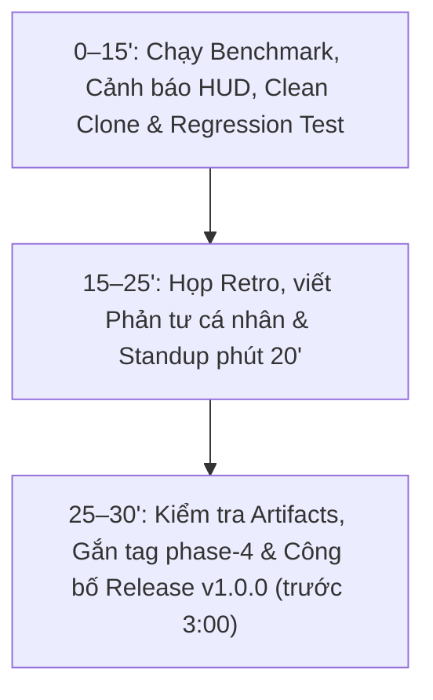

# TICKET-04 — Phát hành v1.0.0 (Phase 4)

> **Thông tin Phase 4**:
> - **Thời lượng**: 30 phút (2:30–3:00) · Day 12 · AI SDLC
> - **Tiêu chuẩn**: Test Contract v1.3
> - **Mốc quan trọng**: Hạn đẩy tag `phase-4` và công bố **GitHub Release v1.0.0** lúc **3:00**

Đo hiệu năng của cảnh lặn, kiểm tra cách người chơi nhận cảnh báo, bàn giao bản chạy được từ repo sạch và tổng kết cách nhóm đã làm việc xuyên suốt buổi lab.

---

## 1. Lõi (mọi nhóm)

### 1.1. Benchmark có render

Chạy lệnh benchmark đồ họa với cấu hình chuẩn:

```bash
<bench_cmd> --seed 42 --duration 30 --out bench.json
```

| Cấu hình | Giá trị chuẩn |
| :--- | :--- |
| **Cảnh đo** | Buổi sáng lõi (`gather`) với độ tươi, đàn cá bơi, Cá Sấu Năm Chèo và hiệu ứng mặc định. Nhân vật Út Sen đứng yên tại bến. |
| **Seed** | `42` |
| **Cửa sổ hiển thị** | $1280 \times 720$ |
| **Làm nóng / Đo** | Làm nóng (warm-up) trong **3 s**, sau đó tiến hành đo trong **30 s**. |

Runner gọi lệnh: `<bench_cmd> --seed <int> --duration <giây> --out <bench.json>`, xuất ra file JSON với đúng 5 trường chuẩn:

```json
{
  "avg_fps": 72,
  "p1_low_fps": 38,
  "frames": 2160,
  "measured_s": 30,
  "load_ms": 2400
}
```

| Trường dữ liệu | Cách tính toán |
| :--- | :--- |
| **`frames`**, **`measured_s`** | Số khung hình và số giây thực tế ghi nhận trong khoảng thời gian đo sau giai đoạn làm nóng. |
| **`avg_fps`** | $\text{avg\_fps} = \frac{\text{frames}}{\text{measured\_s}}$ |
| **`p1_low_fps`** | Chọn $\max(1, \lceil 0.01 \times \text{frames} \rceil)$ khung hình chậm nhất, sau đó lấy nghịch đảo của thời gian khung hình trung bình của chúng (tính theo giây). |
| **`load_ms`** | Thời gian (mili giây) từ lúc khởi chạy chương trình đến khung hình đầu tiên của cảnh đo. |

> [!NOTE]
> - Điểm phần benchmark căn cứ vào việc **chạy được lệnh** và **tạo đúng file `bench.json`**.
> - Các mốc mục tiêu báo cáo: $\text{avg\_fps} \ge 60\text{ FPS}$, $\text{p1\_low\_fps} \ge 30\text{ FPS}$, và $\text{load\_ms} \le 10\text{ s}$.
> - Lưu artifact sinh ra từ commit nộp vào thư mục `docs/proof/phase-4/`.

---

### 1.2. Cảnh báo dễ nhận biết (Accessibility & HUD)

- Cung cấp cảnh báo trực quan bằng **chữ** hoặc **biểu tượng** để người chơi kịp thời nhận ra:
  1. Thủy quái (Cá Sấu) đang ở gần.
  2. Lượng oxy sắp cạn kiệt.
  3. Khách hàng tại quán sắp hết kiên nhẫn.
- Hỗ trợ chế độ **tương phản cao** (High Contrast mode) và tiến hành chơi thử nghiệm cả 3 cảnh báo trên ở chế độ này.

---

### 1.3. Đóng gói và Phát hành (Release)

- **Kiểm thử Clone sạch**:
  - Từ một bản clone sạch (`clean clone`), người dùng có thể chạy được phiên bản có giao diện theo hướng dẫn trong `README.md` với **tối đa 3 lệnh** trên macOS hoặc Linux.
  - File `README.md` phải ghi rõ: yêu cầu môi trường, hướng dẫn điều khiển phím bấm, lệnh chạy test, lệnh chạy headless và lệnh benchmark.
- **Phát hành GitHub Release v1.0.0**:
  - Đính kèm gói binary/source chạy được tại GitHub Release `v1.0.0`.
  - **Release Notes** do nhóm tự soạn thảo: nêu rõ các tính năng mới, hướng dẫn chạy và các giới hạn/lỗi đã biết (known issues).
  - Cập nhật đầy đủ `CHANGELOG.md` theo từng phase (P1 $\rightarrow$ P4).
  - Rà soát tính hợp lệ của `CREDITS.md` và `LICENSE` đối với toàn bộ tài nguyên đã sử dụng (âm thanh, hình ảnh, thư viện).
- **Cập nhật Hợp đồng v1.3**:
  - Đặt `"contract_version": "1.3"`.
  - Khai báo bổ sung `bench_cmd` và `soak_cmd` ngay tại khóa gốc của file `game.contract.json`.
  - Gameplay, thông số tuning, schema kho cá thể và log JSONL tiếp tục tuân thủ theo chuẩn v1.2.

---

## 2. Soak Test Headless (Giảng viên chạy nghiệm thu)

Lệnh thực thi:

```bash
<soak_cmd> --seed 7 --days 10 --out soak.json
```

- **Mô tả kiểm thử**:
  - Lệnh nhận các tham số: `--seed <int> --days <N> --out <soak.json>`.
  - Giảng viên sẽ chạy mô phỏng liên tục **10 Ngày** trong một tiến trình headless duy nhất bằng script input hoặc bot tự động tất định.
  - Mỗi Ngày đi tuần tự qua 3 pha: `gather` $\rightarrow$ `quan` $\rightarrow$ `shop`.
  - Thực đơn và kế hoạch Ngày $1 \rightarrow 5$ lặp lại ở Ngày $6 \rightarrow 10$.
  - Tiền tích lũy, tổng doanh thu, điểm uy tín, cấp nâng cấp mua trong shop, số ngày hoàn thành và ID cá thể (`I1`, `I2`,...) tiếp tục duy trì xuyên suốt.
- **Định dạng file kết quả `soak.json`**:
  - Chứa các trường: `days`, `days_completed`, `crashes`, `results`, `duration_s`.
  - Mỗi phần tử trong mảng `results[]` lưu trạng thái tại thời điểm Shop đóng: `{"day", "earned", "reputation", "score"}`.
- **Tiêu chí đánh giá Đạt**:
  - $\text{days\_completed} = \text{days}$ và $\text{crashes} = 0$.
  - Đối chiếu tính lặp lại (determinism) ở các trường gameplay (bỏ qua sai lệch thời gian thực `duration_s`). Không chấm ngưỡng sử dụng bộ nhớ.

---

## 3. Phần Mở rộng (Extensions)

> [!NOTE]
> **Quy định số lượng mở rộng (tính cho toàn bộ buổi lab)**:
> - **Nhóm 4 người**: Không bắt buộc.
> - **Nhóm 5 người**: Bắt buộc hoàn thành ít nhất **1 mục**.
> - **Nhóm 6 người**: Bắt buộc hoàn thành ít nhất **2 mục**.
> *(Nếu thực hiện, ghi chú rõ ràng vào `README.md` và lưu bằng chứng trong `docs/proof/phase-4/`).*

- **Tự do sáng tạo**: Nhóm có thể hoàn thiện ý tưởng riêng về đồ họa, âm nhạc hoặc hiệu ứng giao diện. Lưu ý: Phải tắt phần tự thêm khi chạy ở chế độ headless hoặc bảo đảm giữ nguyên kết quả theo Test Contract. Ghi tại mục “Sáng tạo của nhóm” trong `README.md`.

---

### 3.1. Mở rộng 1: Bảng xếp hạng cục bộ (`leaderboard`)

- Khai báo `"leaderboard"` trong mảng `extensions` của contract.
- Lưu trữ bền vững (persistent) **Top 10** điểm cao cục bộ. Chỉ ghi nhận một mục cho mỗi lượt chơi chuẩn kéo dài đủ 5 Ngày.
- Sắp xếp điểm giảm dần; trường hợp hòa điểm thì lượt ghi nhận trước đứng trước, bảo toàn thứ tự sau khi khởi động lại ứng dụng.
- **Lệnh trích xuất**:
  ```bash
  <run_cmd> --export-leaderboard <out.json> [--leaderboard <store.json>]
  ```
  File JSON xuất ra có cấu trúc:
  ```json
  {
    "entries": [
      {"name": "Út Sen", "score": 300, "days_completed": 5, "seed": 42}
    ]
  }
  ```
  (`name` là chuỗi ký tự Unicode khác rỗng).
- **Quy tắc chạy Headless**:
  - Chế độ `--mode day` nhận cặp tham số `--leaderboard <store.json> --player-name <name>`.
  - Chỉ ghi nhận một mục khi chạy đủ 5 Ngày chuẩn, không dùng scenario tùy biến và kết thúc với `reason: "days_complete"`.
  - Thiếu một trong hai cờ hoặc sai mode phải trả **mã lỗi 2**.
  - Không làm thay đổi định dạng log JSONL chuẩn; soak test không ghi vào bảng xếp hạng.

---

### 3.2. Mở rộng 2: Phụ đề hiệu ứng âm thanh (`SFX Subtitles`)

- Hiển thị phụ đề trực quan cho toàn bộ các hiệu ứng âm thanh đã triển khai (tiếng nước chảy, quái gầm, chuông khách đến, đồ ăn chín...).
- Chơi thử nghiệm ở chế độ tắt hoàn toàn âm lượng để bảo đảm phụ đề xuất hiện đúng thời điểm và đầy đủ ngữ cảnh.

---

## 4. Quy trình làm việc & Phối hợp nhóm

- **Quy tắc làm việc trên Git**:
  - Commit vào fork chung bằng tài khoản GitHub riêng của từng người.
  - Sử dụng cú pháp `Co-authored-by: Name <email>` khi thực hiện pair programming trên cùng commit.

### 4.1. Phân công vai trò chốt chặng Phase 4

| Vai trò | Trách nhiệm chính | Người phụ trách gợi ý |
| :--- | :--- | :--- |
| **Đóng gói (Packaging)** | Thử nghiệm clone sạch, viết hướng dẫn lệnh chạy, chuẩn bị bundle phát hành. | *Tú / Hải* |
| **Bench / QA** | Chạy benchmark, chạy hồi quy toàn bộ test suite, lưu artifact và ma trận nghiệm thu vào `docs/verification/phase-4.md`. | *Thắng* |
| **Release / Integrator** | Kiểm tra commit bàn giao cuối, soạn thảo Release Notes, rà soát `CHANGELOG.md`, gắn tag và công bố Release. | *Nam* |
| **Điều phối Retro** | Rà soát hành động cải tiến từ retro Phase 2, tổng hợp phản tư và bằng chứng đóng góp của từng thành viên. | *Hải (PO)* |

---

### 4.2. Hoạt động Retrospective & Phản tư cá nhân

1. **Họp Retro nhóm**:
   - Mở đầu bằng việc rà soát các hành động đã cam kết ở retro Phase 2 (nhóm đã làm được gì, còn vướng gì và nguyên nhân).
   - Ghi nhận những điểm làm tốt, điểm cần cải thiện và bài học vào file `docs/retro.md`.
   - Nêu cụ thể ít nhất **1 lỗi do AI tạo ra** và cách nhóm đã phát hiện, sửa chữa.
2. **Tài liệu phản tư cá nhân**:
   - Mỗi thành viên hoàn thiện file `docs/members/<handle>.md` (đảm bảo độ dài $\le 200$ từ).
   - Nội dung bao gồm: phần việc đã làm, đã hỗ trợ ai, AI sai ở điểm nào, bài học rút ra, kèm link commit minh chứng.

---

### 4.3. Lịch trình khuyến nghị (Timeline)



| Mốc thời gian | Nhiệm vụ trọng tâm |
| :---: | :--- |
| **Phút 0–15** | Đo benchmark đồ họa, hoàn thiện cảnh báo HUD và chế độ tương phản cao, thử nghiệm clone sạch, chạy toàn bộ regression test và chuẩn bị dự thảo Release. |
| **Phút 15–25** | Tiến hành họp Retro nhóm và viết phản tư cá nhân. Tại phút 20: Standup nhanh để rà soát vướng mắc, điều chuyển thành viên đã xong sang hỗ trợ các lát việc còn trễ. |
| **Phút 25–30** | Rà soát lần cuối toàn bộ commit, artifacts, tài liệu. Gắn tag `phase-4` và công bố **GitHub Release v1.0.0** chậm nhất lúc **3:00**. |

---

## 5. Định nghĩa hoàn thành (Definition of Done — DoD)

- [ ] **Contract v1.3 chuẩn xác**: Khai báo đầy đủ `bench_cmd` và `soak_cmd` trong `game.contract.json`. Lệnh `bench_cmd` chạy mượt mà trên cảnh chuẩn và xuất ra `bench.json` đúng cấu trúc 5 trường. Lệnh `soak_cmd` sẵn sàng phục vụ runner kiểm thử của giảng viên.
- [ ] **Khả năng chạy từ Clone sạch**: Khởi chạy thành công bản có giao diện bằng tối đa 3 câu lệnh. Đầy đủ 3 cảnh báo trực quan (thủy quái, oxy, khách giận) và chế độ tương phản cao hoạt động ổn định.
- [ ] **Kiểm thử hồi quy đạt 100%**: Toàn bộ regression test từ Phase 1 đến Phase 3 còn hiệu lực đều PASS. Tài liệu `docs/verification/phase-4.md` và thư mục `docs/proof/phase-4/` lưu đầy đủ bằng chứng khớp với commit gắn tag. Cập nhật xong `docs/clarify.md` và `docs/ai-usage-log.md`.
- [ ] **Đóng gói & Phát hành đầy đủ**: File `CHANGELOG.md`, Release Notes và gói phát hành được chuẩn bị chu đáo. Tag `phase-4` và GitHub Release `v1.0.0` cùng trỏ tới commit bàn giao cuối cùng trên nhánh `main`, đẩy lên repo trước **3:00**.
- [ ] **Tổng kết Retro & Phản tư**: File `docs/retro.md` hoàn thành đánh giá chặng cuối. File `docs/members/<handle>.md` của tất cả thành viên được hoàn thiện với đầy đủ bằng chứng đóng góp để phục vụ chấm điểm chéo.
- [ ] **Mở rộng (nếu có)**: Đầy đủ kịch bản kiểm thử và bằng chứng cho các mục mở rộng đã chọn.

---

## 6. Tiêu chí Demo sau giờ Build (Sau 3:00)

Sau mốc 3:00, các nhóm sẽ tiến hành demo trực tiếp hoặc nộp video quay màn hình `.mp4` (thời lượng dưới 5 phút) theo bảng kiểm sau:

- [ ] **Chơi trọn vẹn một Ngày**: Trải nghiệm xuyên suốt từ Lặn & Hái (`gather`) $\rightarrow$ Mở Quán phục vụ (`quan`) $\rightarrow$ Mua sắm cuối ngày (`shop`).
- [ ] **Minh chứng Test Suite**: Chạy toàn bộ bộ test và chứng minh kết quả đều đạt (xanh).
- [ ] **Minh chứng làm việc nhóm**: Chỉ ra bằng chứng phân chia công việc, quy trình phối hợp và lịch sử đóng góp (commit/PR) của từng thành viên trong repo chung.
- [ ] **Ma trận truy vết**: Mở ma trận nghiệm thu và đối chiếu chính xác các bằng chứng kiểm thử tương ứng.
